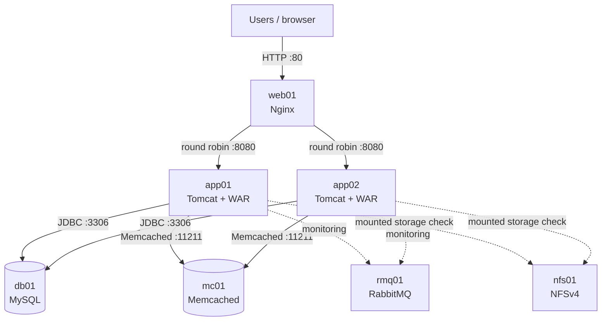

# DevOps Infrastructure Dashboard

[](https://openjdk.org/projects/jdk/21/)
[](https://tomcat.apache.org/tomcat-10.1-doc/)
[](https://react.dev/)
[](https://www.typescriptlang.org/)
[](https://dev.mysql.com/doc/)
[](https://www.rabbitmq.com/docs)

A hands-on, manually provisioned seven-VM lab that demonstrates how a Java WAR,
an Nginx load balancer, two Apache Tomcat instances, and shared infrastructure
services fit together. The dashboard reports real health observations for the
configured lab while keeping request routing, application health, and static
infrastructure relationships distinct.

> This is a learning and portfolio environment, not a fully highly available
> platform. Nginx, MySQL, Memcached, RabbitMQ, and NFS are single instances and
> remain single points of failure.

## Project objectives

- Provision a resource-conscious multi-tier lab with Vagrant and VMware Fusion
  on an Apple Silicon Mac.
- Build one Java 21 WAR containing a React/TypeScript frontend and deploy that
  identical artifact to two Tomcat servers.
- Demonstrate Nginx round-robin routing and application-tier failover.
- Exercise JDBC connection pooling and a Memcached cache-aside workflow.
- Monitor all seven VMs without fabricating health or exposing credentials to
  the browser.
- Practice manual deployment, verification, troubleshooting, and rollback.

## Architecture



The Java application implements cache-aside behavior: it checks Memcached and,
on a miss or cache outage, reads MySQL and attempts to populate the cache.
Memcached does **not** connect to MySQL. RabbitMQ and NFS are monitored
infrastructure; this repository does not implement RabbitMQ publishing or
general NFS file-management features.

See [Architecture](docs/architecture.md) for request flow, monitoring flow,
failure behavior, and known single points of failure.

## Lab inventory

| VM | Address | Service | Ports | Vagrant allocation |
|---|---|---|---|---|
| `web01` | `192.168.56.20` | Nginx load balancer | `80/tcp` | 512 MiB, 1 vCPU |
| `app02` | `192.168.56.21` | Apache Tomcat 10.1 | `8080/tcp` | 1,024 MiB, 1 vCPU |
| `app01` | `192.168.56.22` | Apache Tomcat 10.1 | `8080/tcp` | 1,024 MiB, 1 vCPU |
| `rmq01` | `192.168.56.23` | RabbitMQ 4.2.9 | `5672`, `15672/tcp` | 768 MiB, 1 vCPU |
| `mc01` | `192.168.56.24` | Memcached 1.6.9 | `11211/tcp` | 1,024 MiB, 1 vCPU |
| `db01` | `192.168.56.25` | MySQL 8.0.46 | `3306/tcp` | 768 MiB, 1 vCPU |
| `nfs01` | `192.168.56.26` | NFSv4 | `2049/tcp` | 1,024 MiB, 1 vCPU |

The allocations above come from
[`manual_provisioning/Vagrantfile`](manual_provisioning/Vagrantfile). See
[Infrastructure](docs/infrastructure.md) for guest operating systems, resource
constraints, and responsibilities.

## Features

- Nginx round-robin distribution across `app01` and `app02`.
- Current responder identification via response metadata.
- Direct, identity-validating Tomcat peer checks that bypass Nginx.
- MySQL CRUD demonstration with HikariCP and prepared statements.
- Memcached `HIT`, `MISS`, and `UNAVAILABLE` behavior with MySQL fallback.
- RabbitMQ Management API monitoring with bounded TCP-only fallback.
- Linux NFS mount-identity and read-access monitoring, plus an optional safe
  temporary-file write probe.
- Cached, bounded infrastructure probing through
  `GET /api/infrastructure/health`.
- Responsive seven-node topology with accessible status labels and a distinct
  current-responder indicator.
- Browser-local request history and observed latency displays.

## Technology stack

| Area | Technology |
|---|---|
| Backend | Java 21, Jakarta Servlet 6.0, Jackson 2.17, SLF4J/Logback |
| Runtime | Apache Tomcat 10.1; WAR packaging |
| Data | MySQL 8.0.46, Connector/J 8.4, HikariCP 5.1 |
| Cache | Memcached 1.6.9, spymemcached 2.12.3 |
| Monitoring targets | Nginx, Tomcat peers, MySQL, Memcached, RabbitMQ, NFSv4 |
| Frontend | React 18.3, TypeScript 5.5, Vite 6.4, Tailwind CSS 3.4, Recharts 2.12 |
| Testing | JUnit 5, Mockito 5, Vitest 4, Testing Library |
| Lab tooling | Vagrant, VMware Fusion, ARM Linux guests |

## Network communication

| Source | Destination | Purpose |
|---|---|---|
| User/Mac host | `web01:80` | Dashboard and API through Nginx |
| `web01` | `app01:8080`, `app02:8080` | Round-robin proxy traffic |
| Each Tomcat | Both Tomcats on `8080` | Direct instance health checks |
| Each Tomcat | `db01:3306` | JDBC application and health traffic |
| Each Tomcat | `mc01:11211` | Cache operations and health checks |
| Each Tomcat | `rmq01:5672`, `15672` | TCP fallback and Management API monitoring |
| Each Tomcat | `nfs01:2049` | Existing NFSv4 mount and access checks |

These are private lab interfaces. Do not expose MySQL, Memcached, RabbitMQ
management, NFS, or Tomcat directly to untrusted networks. Detailed rules and
risks are in [Networking](docs/networking.md).

## Build and manual deployment

Prerequisites on the build host:

- JDK 21
- Maven 3.9 or newer
- Git

The Maven build installs its configured Node.js 20.15 toolchain, compiles the
frontend, runs Java and frontend tests, and packages the WAR:

```bash
git clone https://github.com/kavinduumayanga/devops-infrastructure-dashboard.git
cd devops-infrastructure-dashboard
mvn clean verify
shasum -a 256 target/devops-dashboard.war
```

Deploy the **same** `target/devops-dashboard.war` to both Tomcat hosts and set a
different `APP_INSTANCE_ID` on each. A GitHub push does not update either
Tomcat automatically; this repository contains no deployment pipeline.

Follow the complete [Manual deployment guide](docs/manual-deployment.md) for
database initialization, environment variables, Nginx configuration, rolling
replacement, verification, and rollback.

## Load balancing and failover

Nginx forwards requests to `app01` and `app02` using round robin. The
`X-App-Instance` response header and `/api/instance` payload identify which
Tomcat served a request. Repeated uncached requests should show both IDs while
both upstreams are available.

Stopping one Tomcat demonstrates application-tier failover: after Nginx marks
the failed upstream unavailable, requests should continue through the remaining
Tomcat. This does not make the complete system highly available; `web01` and
the shared service VMs are still single points of failure. Use the controlled
procedure in [Validation](docs/validation.md).

## Data, cache, RabbitMQ, and NFS

- [`db/init.sql`](db/init.sql) creates `devops_demo.demo_records` and inserts
  sample rows only when the table is empty. Database identities and grants are
  deliberately managed outside that script.
- `/api/cache/demo` implements cache-aside behavior and distinguishes a true
  cache miss from an unavailable Memcached server.
- RabbitMQ credentials remain on the Java backend. Management monitoring can
  report version, broker alarm status, object/message counts, and memory when
  the API grants access. TCP fallback is labeled `DEGRADED`, not broker health.
- NFS monitoring verifies that `/mnt/nfs-shared` is the expected NFS mount,
  rather than an ordinary local directory. The application never mounts or
  unmounts filesystems.

## Monitoring API

`GET /devops-dashboard/api/infrastructure/health` returns independent results
for all seven VMs. Supported states are `UP`, `DOWN`, `UNKNOWN`, `CHECKING`,
`STALE`, and `DEGRADED`. A dependency failure stays inside the service list so
one failed probe does not make the complete response unusable.

Configuration is environment-based; start from [`.env.example`](.env.example).
Do not commit populated passwords. Monitoring is optional and disabled by
default for disconnected development.

## API reference

All paths below are relative to the `/devops-dashboard` context:

| Method | Path | Purpose |
|---|---|---|
| `GET` | `/api/instance` | Serving Tomcat identity and runtime information |
| `GET` | `/api/system` | Serving JVM and operating-system information |
| `GET` | `/api/database/health` | JDBC health and pool details |
| `GET`, `POST` | `/api/records` | List or create demonstration records |
| `DELETE` | `/api/records/{id}` | Delete a demonstration record |
| `GET` | `/api/cache/health` | Memcached read/write health |
| `GET`, `DELETE` | `/api/cache/demo` | Run or clear the cache-aside demonstration |
| `GET` | `/api/cache/stats` | Memcached server statistics when available |
| `GET` | `/api/infrastructure/health` | Unified seven-service monitoring snapshot |

The dashboard provides Overview, Application Servers, Database, Cache, Request
Activity, and System Information pages. API responses identify the serving
instance, and API responses are configured to avoid stale load-balancer samples.

## Screenshots

No verified runtime screenshots are currently stored in the repository. The
[screenshot capture guide](docs/screenshots/README.md) lists the real views to
capture after the lab is running and defines filenames and redaction checks.
Image links should only be added here after those files exist.

## Verification

```bash
mvn clean verify
```

The build runs Java unit tests, frontend component tests, the TypeScript/Vite
production build, and WAR packaging. The expected artifact is
`target/devops-dashboard.war`. Runtime infrastructure must be validated
separately; see [Validation](docs/validation.md) for reproducible checks and
expected outcomes rather than fabricated sample output.

## Troubleshooting

The detailed [Troubleshooting guide](docs/troubleshooting.md) covers the lab’s
resource, package, Java, Maven, JDBC, MySQL, Memcached, firewall, Tomcat, and
multi-instance monitoring issues. Begin with service status and logs; do not
disable the firewall or delete database files as a first response.

## Lessons learned

- Application-tier redundancy is useful but does not remove infrastructure
  single points of failure.
- Identical artifacts plus runtime configuration make two-node deployment
  reproducible.
- Cache misses and cache outages are different operational states.
- A reachable TCP port is weaker evidence than a service-native health check.
- Health work needs timeouts, bounded concurrency, caching, and lifecycle
  cleanup just like user-facing work.
- Small VMs make package installation and JVM memory planning visible concerns.
- Per-instance monitoring caches can produce temporarily different snapshots
  behind a round-robin load balancer.

## Future enhancements

- Add authenticated, role-based access before use outside a trusted lab.
- Automate repeatable provisioning while retaining the manual guide as a
  learning reference.
- Add CI for build/test checks and an explicitly approved deployment workflow.
- Remove remaining single points of failure where the lab budget allows.
- Add HTTPS, secret-management integration, and certificate rotation.
- Capture and publish redacted screenshots from the real running lab.

## Repository guide

- [Architecture](docs/architecture.md)
- [Infrastructure](docs/infrastructure.md)
- [Manual deployment](docs/manual-deployment.md)
- [Networking](docs/networking.md)
- [Validation](docs/validation.md)
- [Troubleshooting](docs/troubleshooting.md)
- [Screenshot capture guide](docs/screenshots/README.md)
- [Environment variable template](.env.example)
- [Vagrant definitions](manual_provisioning/Vagrantfile)
- [Database initialization](db/init.sql)
- [Maven build](pom.xml)

## License

No license file is currently included. The repository is presented as a DevOps
learning and portfolio project; add an explicit license before inviting reuse
or contributions.
