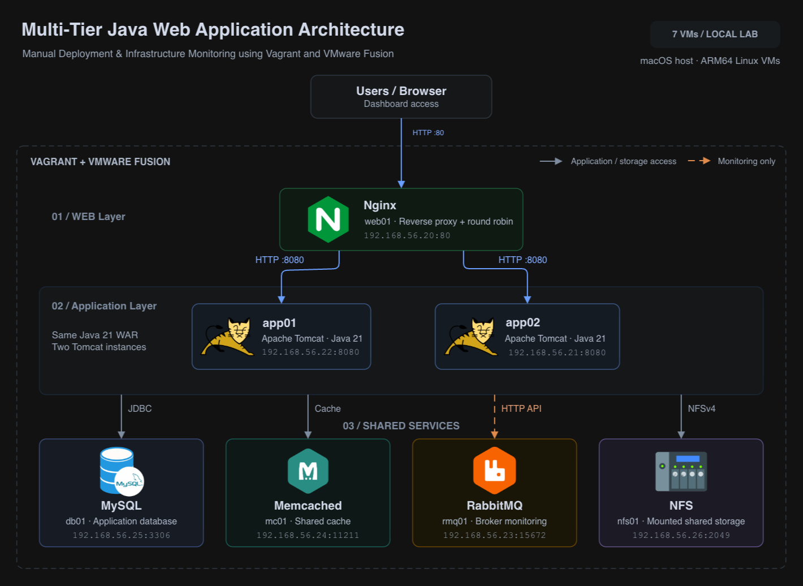
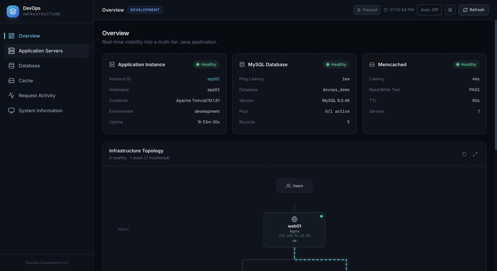
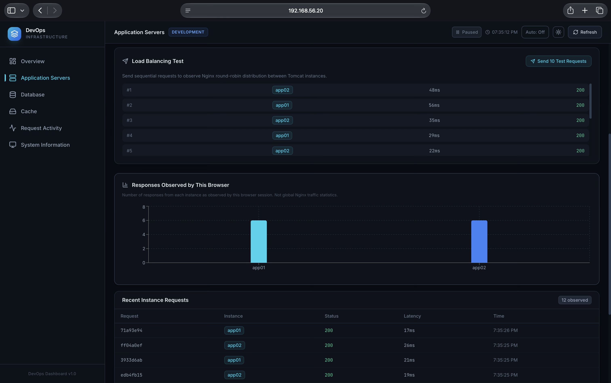
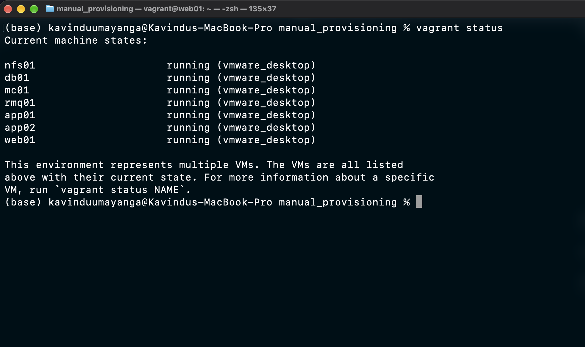

# Multi-Tier Java Web Application Deployment & Infrastructure Monitoring

*A beginner-friendly, hands-on DevOps project using Vagrant, VMware Fusion, Linux, Nginx, Tomcat, MySQL, Memcached, RabbitMQ, and NFS.*

## Project Overview

This is my first hands-on DevOps project, built to learn and practise DevOps fundamentals through real implementation. I manually configured multiple Linux virtual machines, deployed a Java application across two Tomcat servers, and created a dashboard that monitors the infrastructure hosting it instead of using a normal sample website. Along the way, I gained practical experience troubleshooting installation, networking, memory, and service configuration issues.

## Architecture

The project runs locally across seven Linux virtual machines created with Vagrant and VMware Fusion. Nginx receives browser traffic and distributes requests between two Tomcat servers. Both application servers use the shared MySQL, Memcached, and NFS services, while the dashboard also monitors RabbitMQ and the infrastructure hosting it.

The editable diagram is available in [draw.io format](docs/architecture/infrastructure.drawio).

## Technologies Used

| Technology | Purpose |
|---|---|
| Vagrant | Creating and managing the virtual machines |
| VMware Fusion | Running the virtual machines locally |
| Linux | Server operating systems |
| Nginx | Reverse proxy and round-robin load balancing |
| Apache Tomcat | Hosting the Java web application |
| Java + Maven | Application development and WAR building |
| MySQL | Shared application database |
| Memcached | Shared application cache |
| RabbitMQ | Message broker and infrastructure monitoring target |
| NFS | Shared file storage for the application servers |
| Git & GitHub | Source control and project hosting |

## Infrastructure Setup

This is a local infrastructure lab running through Vagrant and VMware Fusion.

| VM | IP address | Role |
|---|---|---|
| `web01` | `192.168.56.20` | Nginx |
| `app01` | `192.168.56.22` | Tomcat 1 |
| `app02` | `192.168.56.21` | Tomcat 2 |
| `db01` | `192.168.56.25` | MySQL |
| `mc01` | `192.168.56.24` | Memcached |
| `rmq01` | `192.168.56.23` | RabbitMQ |
| `nfs01` | `192.168.56.26` | NFS |

## What I Implemented

- Provisioned seven Linux virtual machines.
- Configured Nginx equal-weight round-robin load balancing.
- Deployed the same Java WAR on two Tomcat instances.
- Connected both application servers to a shared MySQL database.
- Implemented Memcached caching.
- Configured RabbitMQ and broker monitoring.
- Configured NFS shared storage and automatic mounting.
- Built a Java dashboard that monitors the seven-VM infrastructure.
- Tested Tomcat failover and recovery through Nginx.

## Project Screenshots

### Infrastructure Monitoring Dashboard

*The dashboard overview shows the active Tomcat instance, MySQL and Memcached health, and the infrastructure topology.*

### Nginx Load Balancing Test

*Test requests alternate between `app01` and `app02`, demonstrating Nginx round-robin load balancing across both Tomcat servers.*

### Vagrant VM Status

*Vagrant reports all seven manually provisioned virtual machines running with the VMware Desktop provider.*

## Challenges & What I Learned

This project helped me understand that DevOps work involves a lot of careful troubleshooting. Some of the issues I worked through included:

- Limited VM memory during package installation.
- MySQL and MariaDB package conflicts.
- MySQL initialization problems.
- Selecting and configuring the correct Java version.
- Linux firewall rules and network connectivity between VMs.
- Memcached startup and private-network binding issues.

Solving these problems improved my confidence with Linux administration, service logs, networking, and multi-server application deployment. Detailed commands and troubleshooting notes will be documented separately.

## Manual Provisioning

The primary completed version of this project was configured manually using Linux commands on each VM. The VM definitions are in the [manual provisioning folder](manual_provisioning/).

A separate beginner-friendly manual provisioning guide will document the installation steps without making this README too long.

## Automated Provisioning

I also explored Bash-based automated provisioning in the [Automated_provisioning folder](Automated_provisioning/). This was a learning exercise, and the complete automated workflow has not yet been fully verified. The manually provisioned infrastructure remains the primary completed project.

## Future Improvements

- Use Ansible for configuration automation.
- Add GitHub Actions for CI/CD practice.
- Explore additional monitoring and centralized logging.
