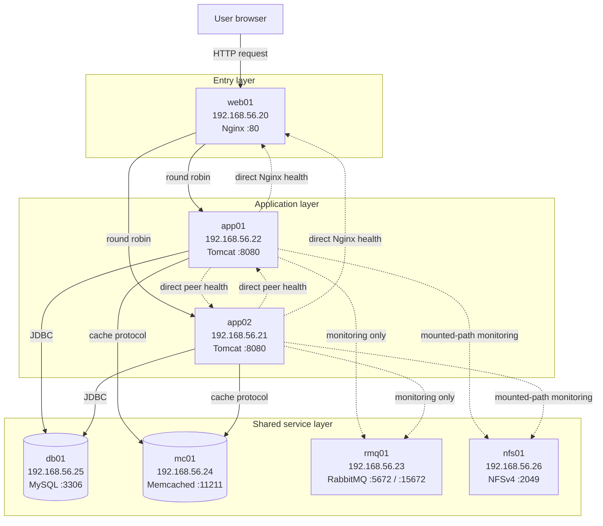
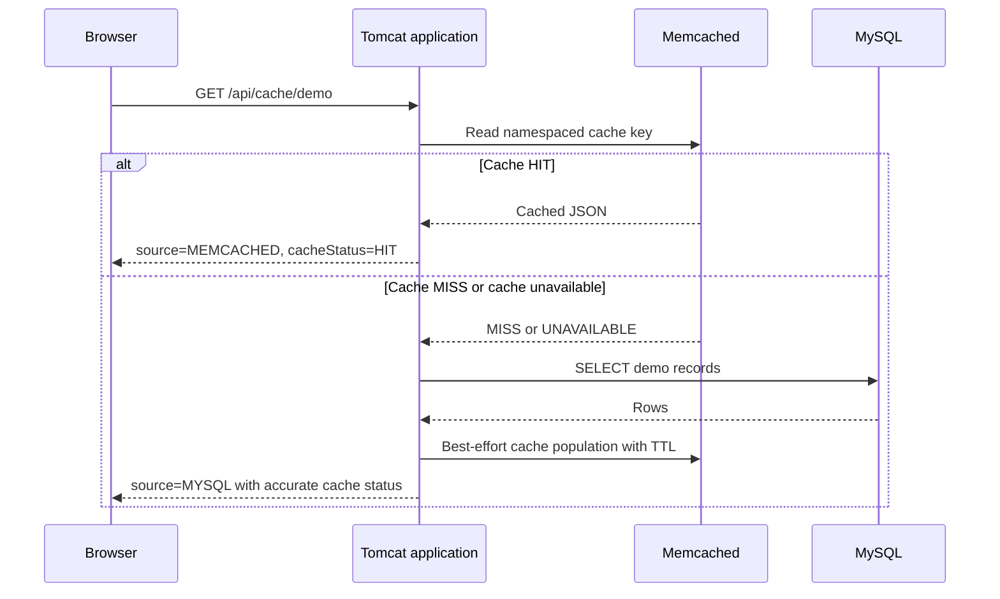
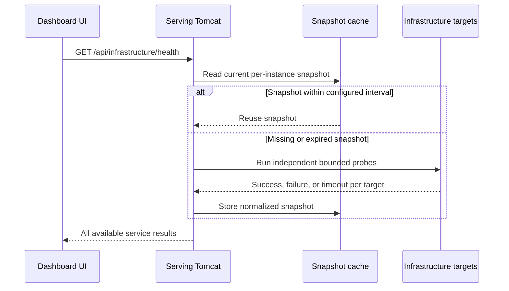

# Architecture

This document describes the implemented seven-VM lab and the data flows visible
in the repository. It deliberately separates application dependencies from
monitoring-only relationships.

## System context

Both Tomcat VMs run the same `devops-dashboard.war`. Runtime environment
variables supply instance identity and service connection details; the binary
artifact is not customized per host.

## Request flow

1. A browser requests `http://192.168.56.20/devops-dashboard/`.
2. Nginx selects `app01` or `app02` from its upstream group using round robin.
3. Tomcat serves the bundled React assets or processes a Jakarta Servlet API
   request.
4. The API filter adds an `X-App-Instance` header and request identifier. The
   API response wrapper also includes the application instance ID.
5. Depending on the endpoint, the Java application may use MySQL or Memcached.
6. Nginx returns the upstream response to the browser.

The browser’s `CURRENT RESPONDER` marker is an observed routing fact for the
request it received. It is not a leader, primary, preferred server, or proof
that the peer is unhealthy.

## Database and cache-aside flow

Memcached never connects to MySQL. The Java application coordinates both
operations. If Memcached is unavailable, the cache demo can still use MySQL.
If MySQL is also unavailable and no usable cached result exists, the endpoint
returns an error rather than a successful empty result.

## RabbitMQ relationship

RabbitMQ is an infrastructure monitoring target. The backend can use its
Management HTTP API to observe the broker version, alarm health, queue and
connection counts, message totals, and reported node memory. Credentials never
go to React. When management access is not configured, the backend performs a
bounded AMQP-port connection test and labels it `DEGRADED` because TCP reachability
does not prove broker health.

No repository code publishes or consumes application messages. Diagram edges
to RabbitMQ therefore mean monitoring, not an application messaging workflow.

## NFS relationship

The operating system mounts `192.168.56.26:/srv/nfs/shared` at
`/mnt/nfs-shared` on a Tomcat host. The application inspects Linux mount
metadata to distinguish that expected NFS filesystem from an ordinary local
directory, then checks read accessibility. An optional probe writes, reads, and
deletes a uniquely named temporary health file.

The application does not mount filesystems, edit `/etc/fstab`, or provide a
general file-management feature.

## Monitoring data flow

The monitor uses a fixed-size executor, bounded queue, per-probe timeouts, and
a per-probe running guard. The guard prevents repeated refreshes from queuing
copies of an NFS operation that remains blocked in the kernel. The executor is
shut down when the WAR is undeployed.

Each enabled Tomcat keeps its own snapshot. Consequently, two consecutive
requests routed to different Tomcats may show observations taken at slightly
different times. That is expected in this architecture and is not evidence of
data corruption.

## Failure scenarios

| Failure | Expected behavior | Remaining limitation |
|---|---|---|
| One Tomcat stops | Nginx can route to the other application server after detecting failure | In-flight requests may fail during detection; capacity is reduced |
| Both Tomcats stop | Nginx has no usable upstream | Dashboard and APIs are unavailable |
| Nginx stops | Public lab entry point is unavailable | Direct Tomcat URLs may still work from permitted hosts |
| MySQL stops | Database health is `DOWN`; CRUD and cache-miss loads fail | Existing cache entries may be temporarily readable, but are not a database replacement |
| Memcached stops | Cache is `DOWN`/`UNAVAILABLE`; cache demo falls back to MySQL | Latency and MySQL load can increase |
| RabbitMQ Management API fails | Service reports failure, or TCP fallback is `DEGRADED` when configured that way | No detailed broker metrics via TCP fallback |
| NFS is unmounted | Probe rejects the local directory as the intended NFS mount | Application monitoring remains available |
| NFS server becomes unreachable | Probe times out where Java can regain control | A hard-mounted kernel I/O call can outlive Java interruption |
| One monitoring snapshot is old | That Tomcat may return stale or different observations | There is no shared monitoring datastore |

## Known single points of failure

- `web01`: only Nginx entry point.
- `db01`: only MySQL server.
- `mc01`: only Memcached server, although the application has database fallback.
- `rmq01`: only RabbitMQ broker.
- `nfs01`: only NFS server.
- The host Mac and its VMware Fusion networking.

The two Tomcat instances provide application-tier redundancy only. This lab
does not claim end-to-end high availability.

## Related documentation

- [Infrastructure](infrastructure.md)
- [Networking](networking.md)
- [Manual deployment](manual-deployment.md)
- [Validation](validation.md)
- [Troubleshooting](troubleshooting.md)
- [Project README](../README.md)
